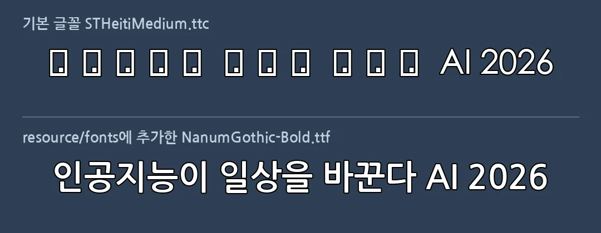

저장소: [github.com/harry0703/MoneyPrinterTurbo](https://github.com/harry0703/MoneyPrinterTurbo) · MIT · Python 3.11 이상 · 최신 릴리스 v1.3.10(2026-11-07)

> 조사 기준일 2026-11-23, `main` 커밋 `86e45a2`(v1.3.10보다 37커밋 앞). 저장소의 코드와 문서를 읽고 썼다. **도구를 설치해 영상을 만들어 보지는 않았다.** 직접 실행해 본 것은 두 가지뿐이다. 내장 글꼴로 한글을 그려 봤고, `claude_code` 제공자가 부르는 Claude Code 명령을 한 번 실행했다.

## 한눈에 보기

- **무엇:** 주제나 키워드를 주면 대본, 음성, 자막, 배경음악, 화면을 모아 쇼츠 한 편을 만드는 오픈소스 도구다. 스타 14만 5천, 포크 2만 3천이다.
- **영상 생성 모델이 아니다.** 기본값은 LLM이 대본과 영어 검색어를 쓰고, Pexels 스톡 영상을 받아 FFmpeg으로 이어 붙이는 **조립 파이프라인**이다. Seedance 같은 생성 모델은 유료 선택지로 붙어 있다.
- **AI 에이전트용 스킬이 공식으로 들어 있다.** `SKILL.md` 하나와 헬퍼 스크립트 하나다. 설치부터 MP4 경로 반환까지 에이전트가 맡는다. 종료 코드로 다음 행동을 정하는 설계는 참고할 만하다.
- **그대로 붙이면 걸리는 점이 있다.** 스킬은 버전을 고정하지 않은 `main`을 내려받고, 설치 전에 묻지 말라고 지시한다. 공식 지원은 macOS와 Windows뿐이고 기본 결과물은 중국어다.
- **한글 자막은 기본 설정에서 깨진다.** 내장 글꼴 9종 모두 한글 글리프가 없다. 한글 TTF를 넣고 지정해야 한다.
- **API 서버는 기본값이 `0.0.0.0` + 인증 없음이다.** 직접 띄운다면 설정부터 바꾼다.

## 무엇을 하는 도구인가

파이프라인은 여섯 단계다. CLI의 `--stop-at`으로 중간에 멈출 수 있다(`app/services/task.py`, `cli.py`).

| 단계 | 하는 일 | 기본값 |
|---|---|---|
| `script` | LLM이 대본 작성. 완성된 대본을 넣으면 건너뜀 | 1문단 |
| `terms` | LLM이 대본에서 스톡 영상 **영어 검색어**를 뽑음 | 5개 |
| `audio` | TTS로 음성 생성 | Edge TTS(무료, 키 없음) |
| `subtitle` | TTS 타임스탬프나 로컬 Whisper로 자막 생성 | TTS 타임스탬프 |
| `materials` | 검색어로 영상을 찾아 내려받음 | Pexels |
| `video` | 최대 5초로 자른 클립을 이어 붙이고 자막·배경음악을 합성 | 9:16(1080×1920) |

"AI 영상 생성기"라는 소개 때문에 오해가 잦다. 8월에 올라온 [이슈 #1183](https://github.com/harry0703/MoneyPrinterTurbo/issues/1183)은 README에 "Seedance나 Wan 같은 text-to-video 모델이 아니다"라고 적어 달라고 제안했다. 댓글을 단 한 이용자는 처음부터 끝까지 AI로 만든 영상을 기대했는데, 결과가 대본과 전혀 맞지 않았다고 썼다. 설명을 고치는 [PR #1190](https://github.com/harry0703/MoneyPrinterTurbo/pull/1190)은 아직 열려 있다.

대본과 화면이 따로 노는 이유는 기본값에 있다. 검색어 5개는 **영상 전체의 주제어**이고, 클립 순서는 **무작위**다. 대본 앞부분 이야기에 뒷부분 화면이 나올 수 있다. 순서를 맞추는 옵션은 꺼져 있다.

- `--match-materials-to-script`를 켜면 검색어가 8개로 늘고 대본 순서대로 만들어진다. 내려받기와 이어 붙이기도 순서를 따른다.
- 검색어를 직접 넣거나(`--video-terms`) 직접 찍은 영상을 쓰면(`--video-source local`) 더 정확하다.

[artcraft 글](/ai-agent/artcraft/)의 구분으로 보면, 이 도구는 내용을 상상하지 않는다. 있는 재료를 규칙대로 조립한다. 기대치를 여기에 맞추면 쓸모가 보인다.

### 쓰는 방법 네 가지

| 방법 | 시작 | 맞는 경우 |
|---|---|---|
| AI 에이전트(스킬) | `SKILL.md` 주소를 에이전트에게 준다 | 채팅으로 한 편 만들기. macOS·Windows만 지원 |
| WebUI | `pip install mpt` 후 `mpt webui`, 또는 `sh webui.sh` | 미리보기를 보며 설정 조정. 한국어 화면 있음 |
| CLI | `uv run python cli.py --video-subject "..."` | 서버, 일괄 작업(`--batch-file`, 최대 100건) |
| API | `uv run python main.py` | 다른 시스템 연동. 보안 설정 먼저(아래) |

GPU는 없어도 된다. LLM·TTS·소재를 모두 온라인으로 쓰면 CPU와 메모리가 더 중요하다(README).

## 에이전트 스킬에서 배울 점

README가 권하는 첫 번째 방법이 에이전트다. 에이전트에게 이렇게 말하면 된다고 한다.

```text
Use this Skill: https://raw.githubusercontent.com/harry0703/MoneyPrinterTurbo/main/docs/skill/SKILL.md
Create a video with the topic "How AI is changing everyday life."
```

구성은 `docs/skill/SKILL.md`(지침)와 `docs/skill/mpt_agent.py`(약 1,000줄, 표준 라이브러리만 사용)다. 지침에 할 일을 길게 쓰는 대신, **판단이 필요 없는 일은 스크립트에 넣고 에이전트는 종료 코드만 보게** 했다.

| 종료 코드 | 헬퍼가 내는 것 | 에이전트가 할 일 |
|---|---|---|
| `0` | `MPT_RESULT`와 `VIDEO_FILE=` 절대 경로. 파일이 있고 비어 있지 않을 때만 출력 | 경로를 그대로 전달. 다시 `ls`로 확인하지 않음 |
| `10` | `MPT_NEEDS_INPUT`과 빠진 설정 목록 | 빠진 값을 **한 번에** 모아서 묻고 다시 실행 |
| `1` | `MPT_ERROR`와 로그 경로 | 고쳐서 한 번만 재시도하고, 안 되면 보고 |

스킬을 직접 만들 때([Custom Skill 글](/ai-agent/custom-skills/)) 가져올 만한 것은 네 가지다.

- **결과를 파일로도 남긴다.** 터미널 출력이 잘려도 `latest-result.json` 하나만 읽으면 성공 여부를 안다.
- **기다리는 방법을 정해 준다.** `sleep`, `ps`, 반복 `tail`로 폴링하지 말고 20분 이상 제한 시간을 준 한 번의 명령으로 기다리라고 적었다. 토큰 낭비를 막는다.
- **돈이 드는 동작은 별도 플래그로 막는다.** Seedance, WaveSpeed 같은 유료 영상 소스는 `--confirm-…-charge`가 없으면 CLI가 거부한다. 지침은 "never add this flag silently"라고 한다. 부탁만 하지 않고 코드가 한 번 막는다. 다만 플래그를 붙이는 주체도 에이전트라 완전한 방어는 아니다.
- **비밀값을 출력하지 않게 한다.** `config.toml` 전체나 키를 찍지 말라고 하고, 헬퍼도 바꾼 항목의 이름만 로그에 남긴다.

## 그대로 붙이기 전에 볼 점

같은 스킬에 조심할 부분도 있다.

- **버전을 고정하지 않는다.** 헬퍼는 처음 실행할 때 `main.zip`을 받아 `~/MoneyPrinterTurbo`에 푼다. 검토한 코드와 설치되는 코드가 다를 수 있다. Python 의존성은 `uv sync --frozen`으로 잠금 파일을 따른다.
- **묻지 말라고 지시한다.** 원문: "Do not ask for confirmation before installing, generating, waiting, using defaults, or returning the result." uv가 없으면 `curl … | sh`로 설치하는 것까지 포함된다. 에이전트의 권한 확인이 마지막 방어선이니 자동 승인 모드에서 처음 돌리지 않는 편이 낫다.
- **한 번 설치하면 갱신하지 않는다.** `~/MoneyPrinterTurbo`에 `cli.py`와 `config.example.toml`이 있으면 그대로 쓴다. 보안 수정이 나와도 직접 올려야 한다.
- **키를 채팅으로 받는 흐름이다.** 빠진 키를 사용자에게 묻고 환경 변수로 넘기면, 헬퍼가 `config.toml`에 평문으로 쓴다. 키가 대화 기록에 남는다. `config.toml`에 미리 적어 두면 묻지 않는다.
- **리눅스는 지원 목록에 없다.** 헬퍼 코드에 OS 검사는 없지만, 스킬과 README 모두 macOS와 Windows만 지원한다고 적었다. 리눅스에서는 CLI나 Docker가 문서에 있는 길이다.
- **기본값이 중국어다.** 따로 말하지 않으면 중국어 음성 `zh-CN-XiaoxiaoNeural-Female`을 쓴다.

버전과 키 문제는 **먼저 태그를 고정해 받아 두면** 피할 수 있다. 헬퍼가 기존 폴더를 재사용하기 때문이다. 아래는 코드를 근거로 구성한 절차이고, 끝까지 돌려 보지는 않았다.

```bash
git clone --depth 1 --branch v1.3.10 \
  https://github.com/harry0703/MoneyPrinterTurbo.git ~/MoneyPrinterTurbo
cd ~/MoneyPrinterTurbo
less docs/skill/SKILL.md docs/skill/mpt_agent.py   # 읽어 보고
mkdir -p ~/.claude/skills
cp -r docs/skill ~/.claude/skills/moneyprinterturbo-video
cp config.example.toml config.toml                 # 키는 여기에 직접 적는다
```

## Claude 구독을 LLM으로 쓰는 제공자

v1.3.7부터 LLM 제공자에 `claude_code`가 있다. API 키 대신 로컬에 로그인된 `claude` CLI를 헤드리스로 부른다(`app/services/llm.py`).

```bash
claude -p --output-format json \
  --system-prompt "You are a concise copywriter. ..." \
  --tools "" --safe-mode
```

스크립트에서 Claude Code를 글쓰기 엔진으로만 쓸 때 좋은 본보기다.

- `--tools ""`로 내장 도구를 모두 끈다.
- `--safe-mode`로 CLAUDE.md, 스킬, 플러그인, 훅, MCP 서버를 끈다. `--bare`와 달리 로그인은 그대로 쓴다. [CLI 문서](https://code.claude.com/docs/en/cli-reference)에 따르면 관리형 설정(managed settings) 정책은 계속 적용된다.
- **빈 임시 폴더**에서 실행하고, 프롬프트는 표준 입력으로 넣는다. Windows의 `claude.cmd`가 줄바꿈에서 인자를 자르기 때문이라고 주석에 적혀 있다.
- `ANTHROPIC_*`, `CLAUDE_CODE_USE_*` 환경 변수를 지우고 부른다. 구독이 아닌 API 과금으로 새는 것을 막는다. 반대로 API 키로 쓰고 싶다면 이 제공자는 맞지 않다.

Claude Code 2.1.260 이상이 필요하다. 2.1.330에서 같은 명령을 **Claude Code 세션 안에서** 실행해 보니 막히지 않았다. 약 2초 만에 한국어 대본 세 문장이 JSON으로 돌아왔다(모델은 `claude-haiku-5-5`로 지정).

약관은 따로 봐야 한다. [Claude Code 법률 문서](https://code.claude.com/docs/en/legal-and-compliance)는 이렇게 적었다. "Anthropic does not permit third-party developers to offer Claude.ai login into their own applications, or to route requests through Free, Pro, Max, or Ultra plan credentials on behalf of their users." 다만 사용자가 수정하지 않은 Claude Code에 자기 구독으로 로그인하는 것을 막지는 않는다고도 썼다. 내 컴퓨터에 설치한 오픈소스가 내 CLI를 부르는 경우를 콕 집어 다룬 문장은 없다. **남에게 서비스로 제공하는 구성이라면 API 키를 쓰는 것이 안전하다.**

ChatGPT 구독을 쓰는 `openai_codex`는 방식이 다르다. Codex CLI를 부르지 않고 앱이 직접 기기 코드로 로그인해 자격 증명을 `storage/auth/`에 보관한다([문서](https://github.com/harry0703/MoneyPrinterTurbo/blob/main/docs/codex-provider.md)).

## 한국어로 쓰려면

음성과 화면 언어는 준비돼 있다. Edge TTS 목록에 한국어 음성이 세 개(SunHi 여성, InJoon 남성, Hyunsu 다국어 남성) 있고, WebUI 한국어 번역도 들어 있다.

문제는 자막이다. `resource/fonts`의 글꼴 9종을 검사하니 **모두 한글 글리프가 없었다.** 기본 글꼴 `STHeitiMedium.ttc`로 같은 조건(60px, 흰 글자, 검은 외곽선)의 한글을 그리면 이렇게 나온다.



WebUI는 글꼴이 글자를 지원하지 않으면 경고를 띄운다. 그 검사는 `webui/Main.py`에만 있어서 **CLI, API, 스킬로 만들면 경고 없이 빈 상자가 영상에 박힌다.** 해결은 글꼴을 넣고 이름을 지정하는 것이다.

```bash
# 소스 설치 기준. pip 설치(리눅스)는 ~/.local/share/MoneyPrinterTurbo/resource/fonts
cp NanumGothic-Bold.ttf resource/fonts/

uv run python cli.py \
  --video-subject "인공지능이 일상을 바꾸는 법" \
  --video-language ko-KR \
  --voice-name ko-KR-SunHiNeural-Female \
  --font-name NanumGothic-Bold.ttf \
  --match-materials-to-script \
  --bgm-type none
```

글꼴은 `.ttf`와 `.ttc`만 받는다. OTF로 배포되는 글꼴은 TTF 판을 구해야 한다. 나눔고딕은 [Google Fonts 저장소](https://github.com/google/fonts/tree/main/ofl/nanumgothic)에 OFL로 올라와 있다. 스킬로 돌릴 때는 `--` 뒤에 같은 옵션을 붙인다.

## 보안·저작권·게시에서 조심할 것

**API 서버는 열려 있다.** `config.example.toml`의 기본값이 `listen_host = "0.0.0.0"`, `api_key = ""`다. 키가 비어 있으면 인증을 건너뛴다. `python main.py`로 띄우면 방화벽이 막지 않는 한 같은 네트워크의 누구나 영상 생성을 요청해 내 LLM·영상 API 한도를 쓰고, 작업 목록과 결과물을 받고, 작업을 지울 수 있다. Docker Compose 파일은 `127.0.0.1`에만 포트를 연다. 직접 띄울 때는 두 줄을 바꾼다.

```toml
listen_host = "127.0.0.1"   # 파일 맨 위

[app]
api_key = "긴 무작위 문자열"  # 클라이언트는 x-api-key 헤더로 보낸다
```

인증 기능 자체가 최근에 생겼다. 5월 [이슈 #882](https://github.com/harry0703/MoneyPrinterTurbo/issues/882)가 "인증 함수는 있는데 모든 라우터에서 주석 처리돼 있다"고 알렸고, 8월 v1.3.5에서야 연결됐다. 이슈가 지적한 상태의 이전 버전은 키를 적어도 적용되지 않는다.

**배경음악은 기본값이 '무작위'다.** 내장곡 29개의 출처를 README는 이렇게 적었다. "The current project includes some default music from YouTube videos. If there are copyright issues, please delete them." 공개할 영상이라면 `--bgm-type none`으로 끄거나 권리를 아는 곡을 넣는다.

**기본 글꼴의 저작권은 따로다.** 글꼴 파일 안의 저작권 표시는 STHeiti가 SinoType, Microsoft YaHei가 Microsoft와 Founder다. YaHei는 "해당 Microsoft 제품의 라이선스 조건에 따라" 쓰라고 적혀 있다. 저장소가 MIT라고 글꼴까지 MIT가 되지는 않는다. 어차피 한글이 안 나오니 OFL 글꼴로 바꾸면 함께 해결된다.

**Pexels는 라이선스와 API 조건이 다르다.** [라이선스](https://www.pexels.com/license/)는 출처 표기가 필수가 아니라고 한다. 반면 [API 가이드라인](https://www.pexels.com/api/documentation/)은 Pexels 링크를 눈에 띄게 보여 주고, 가능하면 작가를 밝히라고 한다. 기본 한도는 시간당 200회, 월 20,000회다. 이 도구는 쓴 영상의 작가와 페이지 주소를 작업 폴더의 `script.json`(`material_sources`)에 남기므로, 설명란에 옮겨 적기 쉽다.

**YouTube 수익화는 '찍어낸 느낌'을 막는다.** [수익화 정책](https://support.google.com/youtube/answer/1311392?hl=en)은 "content that looks like it's made with a template"를 수익화할 수 없는 반복 콘텐츠로 본다. 예시에 "AI-generated content made with generic or unoriginal templates giving the impression of mass production"이 있다. 기본값으로 수십 편을 뽑는 방식은 여기에 걸리기 쉽다.

**합성 표시 의무는 화면에 따라 다르다.** [공개 정책](https://support.google.com/youtube/answer/14328491?hl=en)에서 대본이나 아이디어, 자막을 AI로 만드는 것은 표시 대상이 아니다. 실제로 일어나지 않은 장면을 사실처럼 만든 영상은 표시해야 한다. 스톡 영상 대신 Seedance 같은 생성 소스를 쓰면 후자에 들어갈 수 있다.

**자동 게시는 꺼 둔다.** TikTok·Instagram·YouTube 게시는 외부 서비스 Upload-Post를 거친다. 기본은 꺼져 있지만(`upload_post_auto_upload = false`), 켜면 YouTube 공개 범위 기본값이 `public`이다. 먼저 `private`로 바꾼다.

**이름이 같은 PyPI 패키지에 속지 않는다.** 공식 패키지는 `mpt`(1.3.10)다. `MoneyPrinterTurbo`라는 패키지는 다른 사람이 2024년 6월에 한 번 올린 것인데 버전이 1.4.5라 더 최신처럼 보인다. README도 제3자 패키지라고 밝힌다.

**후원사와 제공자를 구분한다.** 등록된 LLM 제공자가 48개이고, 공식 업체와 재판매 게이트웨이가 섞여 있다. 후원 문구 중에는 "LLMs from 1% of official rates"처럼 파격적인 것도 있다. 대본과 키가 그 업체를 거친다는 점을 생각하고, 이미 계약이 있는 곳이나 로컬 Ollama부터 쓰는 편이 낫다.

## 정리

- 주제만 던져 완성작을 얻는 도구라기보다, **대본이 정해진 설명 영상을 싸게 양산하는 조립기**에 가깝다. 사내 안내, 공지 요약, 제품 사용법처럼 화면이 배경 역할을 하는 영상에 맞는다.
- 돈을 거의 안 들이는 조합은 `claude_code`나 Ollama + Pexels(무료 키) + Edge TTS다. 유료 생성 소스는 컷마다 과금되니 확인 플래그를 함부로 붙이지 않는다.
- 스킬은 **태그를 고정해 받아 두고**, 키는 `config.toml`에 직접 적고, 한글 글꼴을 넣은 뒤 쓴다.
- 대본을 직접 쓰거나 다듬고, 순서 맞춤을 켜고, 음악을 바꾼다. 이 세 가지가 결과물의 질과 수익화·저작권 위험을 함께 줄인다.
- 스킬을 만드는 사람이라면 영상보다 `docs/skill`을 읽을 가치가 있다. 종료 코드 규약, 결과 파일, 과금 확인 플래그는 다른 작업에도 그대로 쓸 수 있다.

## 참고

- [MoneyPrinterTurbo 저장소](https://github.com/harry0703/MoneyPrinterTurbo), [영문 README](https://github.com/harry0703/MoneyPrinterTurbo/blob/main/README-en.md), [v1.3.10 릴리스 노트](https://github.com/harry0703/MoneyPrinterTurbo/releases/tag/v1.3.10), [v1.3.5 릴리스 노트](https://github.com/harry0703/MoneyPrinterTurbo/releases/tag/v1.3.5)
- [docs/skill/SKILL.md](https://github.com/harry0703/MoneyPrinterTurbo/blob/main/docs/skill/SKILL.md), [docs/skill/mpt_agent.py](https://github.com/harry0703/MoneyPrinterTurbo/blob/main/docs/skill/mpt_agent.py)
- [이슈 #1183: 영상 생성 방식 설명 요청](https://github.com/harry0703/MoneyPrinterTurbo/issues/1183), [이슈 #882: API 인증](https://github.com/harry0703/MoneyPrinterTurbo/issues/882)
- PyPI: [mpt](https://pypi.org/project/mpt/)(공식), [MoneyPrinterTurbo](https://pypi.org/project/MoneyPrinterTurbo/)(제3자)
- [Claude Code 법률·규정 문서](https://code.claude.com/docs/en/legal-and-compliance), [CLI 레퍼런스](https://code.claude.com/docs/en/cli-reference)
- [YouTube 수익화 정책](https://support.google.com/youtube/answer/1311392?hl=en), [AI 콘텐츠 공개 정책](https://support.google.com/youtube/answer/14328491?hl=en)
- [Pexels 라이선스](https://www.pexels.com/license/), [Pexels API 문서](https://www.pexels.com/api/documentation/)
- 관련 글: [artcraft](/ai-agent/artcraft/), [Custom Skill](/ai-agent/custom-skills/), [Ruflo 조사](/ai-agent/ruflo/)
