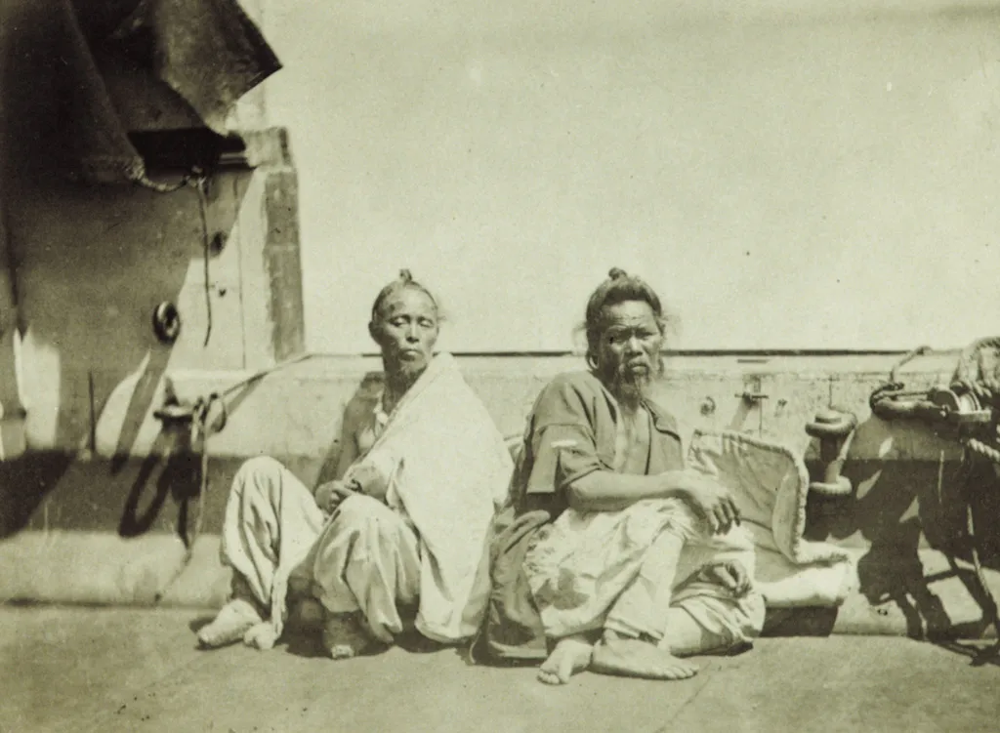
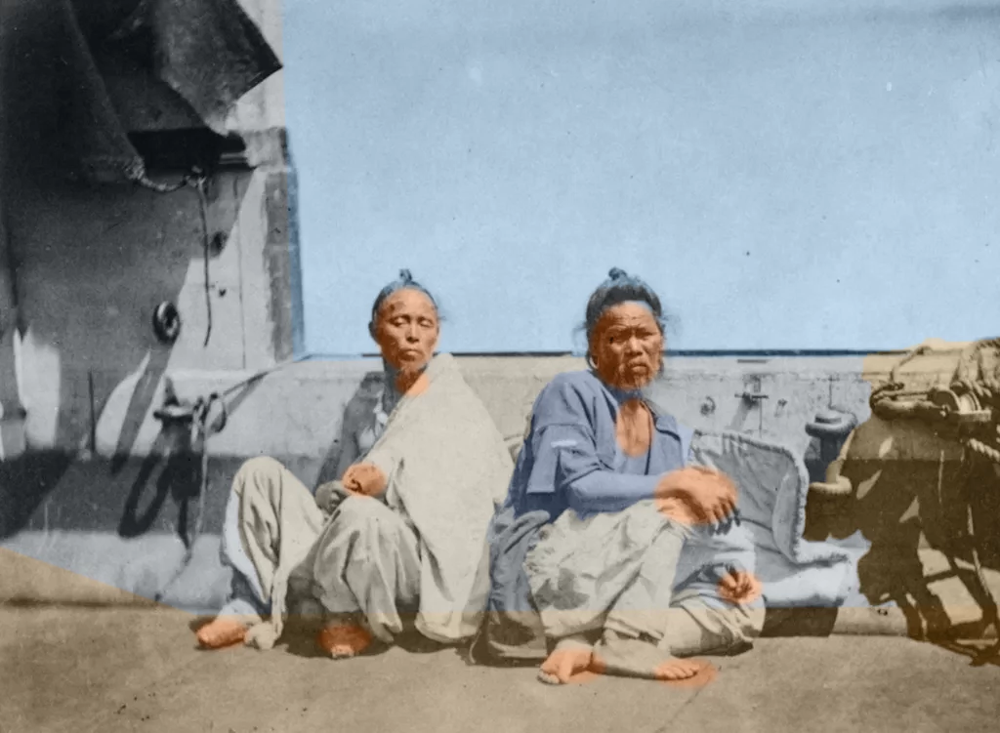

사이트: [getartcraft.com](https://getartcraft.com/) · 저장소: [github.com/storytold](https://github.com/storytold) · 오픈소스, 구독 없음 · macOS, Windows, 웹

artcraft는 상용 크리에이티브 앱의 대체재를 모아 놓은 스튜디오입니다. PhotoCraft(Photoshop), VectorCraft(Illustrator), FilmCraft(Premiere), EffectCraft(After Effects), LightCraft(Lightroom), DesignCraft(InDesign), FigCraft(Figma), SoundCraft(Pro Tools), CADCraft(AutoCAD)에 PdfCraft, WordCraft, DeckCraft, GridCraft까지 13종입니다. 이 글은 그중 9종을 Claude Code에 MCP 서버로 붙여 실제로 써 본 기록입니다.

결론부터 말하면, artcraft는 에이전트에게 **손**을 줍니다. **눈과 상상**은 주지 않습니다. 그 차이를 모르고 쓰면 오늘 저처럼 실망하고, 알고 쓰면 꽤 쓸 만한 자리가 있습니다.

## 어떻게 붙이는가

앱마다 `<앱>-cli mcp`가 헤드리스 MCP 서버로 뜹니다. 창을 띄우지 않고 엔진만 돌리며, 파일을 읽고 쓸 루트를 인자로 제한할 수 있습니다. 프로젝트의 `.mcp.json`은 이렇습니다.

```json
{
  "mcpServers": {
    "photocraft": {
      "command": "photocraft-cli",
      "args": ["mcp", "--automation-read-root", ".", "--automation-write-root", "."]
    },
    "vectorcraft": { "command": "vectorcraft-cli", "args": ["mcp", "..."] },
    "cadcraft":    { "command": "cadcraft-cli",    "args": ["mcp"] },
    "figcraft":    { "command": "figcraft-cli",    "args": ["mcp"] }
  }
}
```

모든 앱의 도구 구조가 같습니다. 메뉴 항목 하나하나가 명령이고, 에이전트는 명령 id와 JSON 파라미터로 그것을 호출합니다.

| 도구 | 역할 |
|---|---|
| `command_list` | 명령 id, 파라미터 문서, 지금 실행 가능한지와 불가능한 이유 |
| `command_run` / `command_batch` | 명령 하나 또는 여러 개를 순서대로 실행. 되돌리기 가능 |
| `doc_inspect` | 레이어 트리, 선택 영역, 히스토리를 JSON으로 |
| `render_preview` | 평탄화한 PNG 미리보기. 에이전트가 결과를 눈으로 확인하는 유일한 수단 |
| `doc_save` / `doc_export` | 네이티브 포맷 저장 또는 다른 포맷으로 내보내기 |

PhotoCraft 기준으로 명령이 수백 개입니다. 레이어, 선택, 조정 레이어, 필터, 블렌딩 옵션, 내용 인식 채우기까지 Photoshop 메뉴에 있는 것은 대부분 있습니다. 앱이 창을 띄운 상태로 `--control` 포트를 열면 `ui_*` 도구로 실제 화면을 클릭하고 스크린샷을 찍는 브리지 모드도 됩니다.

## 실험: 세피아 사진을 컬러로

1900년 전후로 보이는 세피아 사진 한 장을 주고 "photocraft로 컬러 사진으로 작업해 줘"라고 했습니다.



먼저 명령 목록에서 컬러화를 찾았습니다. `coloriz`, `neural`로 검색하면 결과가 없습니다. AI 기반 자동 컬러화는 없습니다. 있는 것은 Hue/Saturation의 colorize 옵션, Color Balance, Selective Color, Color Lookup 같은 전통적인 조정 도구와, 선택 도구로는 Subject, Sky, Object Selection, Quick Selection, Magic Wand, Color Range입니다.

그래서 사람이 Photoshop에서 손으로 컬러화하는 방식을 그대로 흉내 냈습니다.

1. Hue/Saturation으로 채도를 빼서 세피아를 중립 회색으로 만든다.
2. 영역을 선택하고, 그 선택을 마스크로 하는 단색 채움 레이어를 만들고, 블렌드 모드를 Color로 바꾼다.
3. 하늘, 바닥, 바구니, 저고리, 흰옷, 피부 순으로 2를 반복한다.

```json
[
  {"id": "image.adjustments.hueSaturation", "params": {"saturation": -100}},
  {"id": "select.lasso", "params": {"points": [[288,0],[1024,0],[1024,348],[945,352],[930,366],[300,370]]}},
  {"id": "select.subject", "params": {"mode": "subtract"}},
  {"id": "layer.newFillLayer.solidColor", "params": {"color": "#9cc0dd"}},
  {"id": "layer.layerStyle.blendingOptions", "params": {"blend": "color", "opacity": 65}},
  {"id": "select.rect", "params": {"x": 385, "y": 295, "width": 65, "height": 85, "ellipse": true}},
  {"id": "select.modify.feather", "params": {"radius": 3}},
  {"id": "layer.newFillLayer.solidColor", "params": {"color": "#d4956c"}},
  {"id": "layer.layerStyle.blendingOptions", "params": {"blend": "color", "opacity": 85}}
]
```

명령 자체는 잘 돌아갑니다. 배치 하나에 25단계를 넣어도 한 번에 끝나고, 실패하면 몇 번째 단계가 왜 실패했는지 알려 줍니다. 미리보기를 보고 다시 고치는 루프도 자연스럽습니다. 문제는 결과물입니다.



세 번 고친 결과가 이렇습니다. 하늘과 바닥은 그럴듯하고 저고리의 쪽빛도 봐 줄 만합니다. 하지만 얼굴과 손은 타원 안쪽만 주황색이고, 피부 경계가 옷으로 번지고, 하늘과 선체의 경계에 직선이 보입니다. 컬러화 앱이나 생성 모델이 내는 결과와는 비교할 수준이 아닙니다.

### 왜 이렇게 되는가

도구 탓이 아닙니다. 에이전트가 **좌표를 눈대중으로 찍었기** 때문입니다.

- Sky 선택은 밝은 옷과 벽까지 하늘로 잡았습니다. 밝기 기반이라 세피아 사진에서는 구분을 못 합니다.
- Quick Selection으로 피부를 찍으면 명도가 비슷한 흰옷까지 한 덩어리로 번졌습니다.
- 결국 얼굴, 손, 발을 타원 11개로 직접 그렸습니다. 1024×751 이미지에서 "왼쪽 얼굴은 대략 x 385~450, y 295~380"이라고 추정하는 식입니다.

사람이 Photoshop에서 컬러화할 때 하는 일의 핵심은 "어디까지가 피부이고 어디부터 옷인가"를 **보는** 것입니다. 그 뒤의 클릭은 부수적입니다. artcraft는 그 클릭을 완벽하게 대신해 주지만, 보는 일은 여전히 에이전트 몫이고, 텍스트 모델이 좌표로 보는 능력은 사람 손에 한참 못 미칩니다. Photoshop에서도 컬러화는 편집기가 아니라 Neural Filter, 즉 별도 모델이 합니다.

## 역할을 가르는 기준

이 실험에서 얻은 기준은 하나입니다. **픽셀이나 파형을 상상해야 하는가.**

| 상상이 필요한 것 | 숫자와 규칙으로 다 적히는 것 |
|---|---|
| 사진 컬러화, 배경 생성, 인물 보정 | 치수표로 그리는 CAD 도면 |
| 음악, 자연스러운 음성, 실사 영상 | 좌표와 색이 정해진 벡터 도형, 아이콘, 차트 |
| "분위기 좋게", "더 세련되게" | 텍스트와 사진 위치가 정해진 명함, 카드뉴스, 보고서 레이아웃 |
| 객체 경계를 보고 선택하기 | 도형과 텍스트만으로 된 UI 화면, 모션 그래픽 |
| | 기존 클립을 규칙대로 자르고 붙이는 영상과 음원 조립 |

왼쪽은 생성 모델의 일이고, 오른쪽은 artcraft가 모델 없이도 처음부터 만들 수 있는 것입니다. "artcraft로는 생산을 못 한다"고 하면 틀립니다. 스펙이 곧 결과인 산출물은 잘 만듭니다. 못 만드는 것은 스펙으로 적을 수 없는, 보고 판단해야 하는 결과물입니다.

정리하면 생성 모델은 **내용**을 만들고, artcraft는 **구조와 마감**을 만듭니다.

## 그래서 어디에 쓰는가

쓰임새는 생성이 아니라 **마감과 양산**입니다. 공통 패턴은 네 가지입니다.

- 입력이 표나 파일 목록이고 출력이 그만큼 많아지는 일
- 틀은 같은데 손이 많이 가는 반복 작업
- 결과를 다시 열어 규격 위반을 기계적으로 검사하는 일
- 한 번 정한 스펙을 나중에 똑같이 다시 만들어야 하는 일

명령이 JSON이라는 점이 여기서 힘을 냅니다. 같은 배치를 파일 300개에 돌리면 300개가 똑같은 규격으로 나오고, 석 달 뒤에 같은 배치를 돌려도 같은 결과가 나옵니다.

앱별로 떠오르는 예시입니다.

| 앱 | 맞는 일 |
|---|---|
| PhotoCraft, LightCraft | 상품 사진 수백 장 크롭·배경 정리·규격별 내보내기, 카탈로그 정리와 중복 제거, 프리셋으로 톤 통일, 스캔 사진 먼지 제거와 기울기 보정 |
| DesignCraft, FigCraft | 직원 명단으로 명함·사원증 일괄 생성, 카드뉴스 템플릿에 데이터만 교체, 디자인 토큰 변경 시 전체 치환, 규격별 스토어 스크린샷, 컴포넌트 명명 규칙 검사 |
| VectorCraft | 로고 한 종을 변형 규칙대로 20종 전개, 아이콘 200개 선 굵기 통일과 SVG 최적화, 데이터로 차트 생성 |
| CADCraft | 치수표로 부품 도면 생성과 규격 변경 시 재생성, 레이어·선 종류·글꼴 표준화, 평면도에서 면적 추출 |
| FilmCraft, EffectCraft, SoundCraft | 강의 녹화본에 오프닝·자막·엔딩 규칙 적용, 챕터 단위 쇼츠 변환, 자막 파일 입히기, 팟캐스트 음량 정규화, 지역별 텍스트만 바꾼 영상 버전 |

## 생성이 필요한 요청은 둘로 나눈다

컬러화 같은 요청을 꼭 다루고 싶다면 구조를 나누면 됩니다.

1. 컬러화 모델이나 이미지 생성 API가 색, 배경, 객체 같은 **내용**을 만든다.
2. artcraft가 그 결과를 원본 위에 레이어로 올려 마스크, 블렌드, 미세 색 보정, 포맷별 내보내기를 맡는다.

오늘 제가 타원 11개를 좌표로 그리던 자리를 모델이 대신하면 품질 격차는 대부분 사라집니다. 반대로 모델만 쓰면 "결과를 원본 크기로, 레이어를 살려서, 세 가지 규격으로"는 안 나옵니다. 둘을 합쳐야 사진 한 장을 넣으면 규격별 광고 소재 수십 종이 나오는 파이프라인이 됩니다.

## 정리

- artcraft는 상용 크리에이티브 앱의 메뉴 전체를 JSON 명령으로 노출하는 MCP 서버 묶음이다. 명령 실행, 배치, 상태 검사, 미리보기, 내보내기가 모두 안정적으로 된다.
- 하지만 에이전트에게 주는 것은 손이다. 이미지를 보고 경계를 판단하거나 없는 것을 상상하는 능력은 주지 않는다. 컬러화 실험이 그걸 확인해 줬다.
- 쓰임새는 마감과 양산이다. 입력이 목록이고 틀이 고정된 반복 작업, 규격 검사, 스펙 재현에 쓴다.
- 상상이 필요한 결과물은 생성 모델이 내용을 만들고 artcraft가 구조와 마감을 맡는 2단 구조로 간다.

다음은 위 표에서 하나를 골라 실제 파이프라인으로 만들어 보는 것입니다. 후보는 상품 사진 일괄 규격화입니다.
